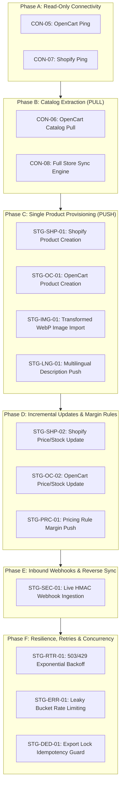

# External Staging Integration Readiness & Verification Plan
## Gate D.1 Unblocking Architecture — Shopify & OpenCart Staging

**Audit Baseline Commit:** `7628cf5f812c5956cedad1e03a1960b27f8eb077`  
**Certified Hardened HEAD:** `78ee324d9be160d1de9f8c4c7edfd572d78a1232`  
**Target Release Gate:** `Gate D.1 (External Store Staging Integration)`  
**Current Gate Status:** `BLOCKED` (Pending live external store instances and credentials)  
**Document Classification:** Authoritative Staging Integration Specification  

---

## 1. Executive Summary & Purpose

The Product Intelligence AI platform has achieved **60/60 local component verification** across PostgreSQL schema integrity, multi-tenant isolation, BullMQ queues, error telemetry, storage accounting, Sharp image processing, and Stripe sandbox billing.

However, production launch remains conditionally blocked pending live external store validation (**Gate D.1**). In the master test registry, **15 integration tests** are categorized as `BLOCKED`:
- **4 Unit/Integration Test Cases in `@saas/connectors`:** `CON-05`, `CON-06`, `CON-07`, and `CON-08`.
- **11 Real-World Staging Matrix Scenarios:** `STG-SHP-01`, `STG-SHP-02`, `STG-OC-01`, `STG-OC-02`, `STG-IMG-01`, `STG-LNG-01`, `STG-PRC-01`, `STG-RTR-01`, `STG-DED-01`, `STG-SEC-01`, and `STG-ERR-01`.

The objective of this plan is to establish the complete prerequisite framework, exact step-by-step setup guides, confirmed defect remediations, and a structured 15-test execution matrix required to unblock Gate D.1 safely, efficiently, and at **zero financial cost**.

---

## 2. Existing Connector Implementation Inventory

The platform does not require architectural redesign or connector rebuilding. The universal integration subsystem is already fully engineered:

| Component | Repository Path | Platform / Responsibility | Current Readiness Status |
| :--- | :--- | :--- | :--- |
| **Shopify Adapter** | `packages/connectors/src/adapters/shopify.ts` | Shopify REST Admin API adapter. Handles product catalog extraction, variant matrices, SEO metafield tags, stock level synchronization, and HMAC signature verification. | **READY** (Version-compatible with Shopify REST Admin API) |
| **OpenCart Adapter** | `packages/connectors/src/adapters/opencart.ts` | OpenCart SaaS adapter. Supports dual-mode communication (Official OCMOD Extension and Standalone Bridge `saas_bridge.php`), HMAC-SHA256 request signing, and multilingual mapping. | **READY** (Remediated: live product pull and stock update wired) |
| **OpenCart OCMOD Extension** | `packages/connectors/opencart-extension/` | Complete OpenCart 3.x/4.x extension package including admin UI controllers, models, catalog storefront endpoints, option engine, image importer, and replay attack protection. | **READY** (Packaged as `apps/api/public/saas_connector.ocmod.zip`) |
| **Standalone OpenCart Bridge** | `packages/connectors/src/bridge/saas_bridge.php` | Zero-configuration drop-in PHP gateway file that auto-reads OpenCart `config.php`, bypassing extension installer permission issues. | **READY** (Available via `/download-bridge` route) |
| **Store Export Execution Service** | `apps/api/src/services/store-export-execution.service.ts` | Multi-store atomic export orchestrator. Manages Change Plans, selective field overrides, pricing engine markup rules, multi-language descriptions, and post-write verification. | **READY** (Tested locally across multi-tenant boundaries) |
| **Inbound Webhook Gateway** | `apps/api/src/services/inbound-store-webhook.service.ts` | Public ingestion gateway for reverse synchronization (`products/update`, `inventory_levels/update`, `products/delete`). Handles HMAC validation and store product unlinking. | **READY** (Protected against unauthorized and forged webhooks) |
| **Synchronization Engine** | `packages/connectors/src/sync.ts` | Universal factory and batch sync orchestrator. Manages store mappings (`store_product_mappings`), conflict logs, and sync run audits (`store_sync_history`). | **READY** (Tested locally via `SynchronizationEngine`) |
| **Store Management API** | `apps/api/src/routes/store.routes.ts` | REST API for store onboarding, credential encryption, SSRF URL filtering, module downloads, and live connectivity probes. | **READY** (Tested locally with AES-256-GCM encryption) |

---

## 3. External Staging Prerequisites Checklist

To transition Gate D.1 from `BLOCKED` to `PASS`, the following external infrastructure must be provisioned:

- [ ] **Shopify Partner Development Store:**
  - A permanent, sandbox-mode Shopify store created under a free Shopify Partner account.
  - Custom App installed with Admin API credentials (`shpat_...`).
  - Scopes: `read_products`, `write_products`, `read_inventory`, `write_inventory`, `read_locations`.
- [ ] **OpenCart 4.x or 3.x Staging Instance:**
  - An accessible OpenCart instance (either local container with public tunnel or hosted staging server).
  - Web server running PHP 8.1+ with `mysqli`, `curl`, and `gd` extensions enabled.
  - Active admin account with permissions to install extensions or upload files.
- [ ] **Public HTTPS Webhook Tunnel:**
  - Inbound store webhooks require a publicly routable HTTPS endpoint to deliver payloads to the local API server (`http://localhost:4000`).
  - Zero-cost tooling: Cloudflare Tunnel (`cloudflared`) or ngrok.
- [ ] **Image Asset Origin / CDN:**
  - External e-commerce stores fetch product images via HTTP/HTTPS during export.
  - Staging images must be served from a publicly resolvable URL (e.g., local server exposed via Cloudflare Tunnel or an S3/MinIO bucket).

---

## 4. Exact Configuration & Step-by-Step Setup Guides

### 4.1 Shopify Partner Development Store Setup (Zero-Cost)

1. **Sign Up for Shopify Partners:**
   - Navigate to `https://partners.shopify.com` and register for a free account.
2. **Create Development Store:**
   - From Partner Dashboard, click **Stores** > **Add store** > **Create development store**.
   - Select **Create a store for testing or building apps**.
   - Store name: `product-intel-staging-[tenant]` (creates `product-intel-staging-[tenant].myshopify.com`).
   - Developer preview: Unchecked (use standard latest release).
   - Data: Select "Start with test data" to preload demo products and collections.
3. **Configure Custom App & Scopes:**
   - Log into the development store admin panel (`https://[store].myshopify.com/admin`).
   - Navigate to **Settings** > **Apps and sales channels** > **Develop apps**.
   - Click **Allow custom app development** and confirm.
   - Click **Create an app**. App name: `Product Intelligence AI Engine`.
   - Click **Configure Admin API scopes**. Select:
     - `read_products`, `write_products`
     - `read_inventory`, `write_inventory`
     - `read_locations`
   - Set **Webhook API version** to `2024-04` or `2024-10`.
   - Click **Save**.
4. **Install App & Record Credentials:**
   - Click **Install app** and confirm.
   - Under **Admin API access token**, click **Reveal token once** and copy the secret token (`shpat_xxxxxxxxxxxxxxxxxxxxxxxxxxxxxxxx`).
   - Record the following configuration parameters:
     ```env
     SHOPIFY_STORE_DOMAIN=product-intel-staging-[tenant].myshopify.com
     SHOPIFY_ADMIN_ACCESS_TOKEN=shpat_xxxxxxxxxxxxxxxxxxxxxxxxxxxxxxxx
     SHOPIFY_API_VERSION=2024-04
     ```
   > [!WARNING]
   > Shopify Admin API tokens are displayed only once. Secure them immediately in a password manager. Do not commit credentials to git.

5. **Configure Inbound Webhooks:**
   - In Shopify Admin, navigate to **Settings** > **Notifications** > **Webhooks** (or configure within the custom app).
   - Click **Create webhook**:
     - Event: `Product creation`, `Product update`, `Product deletion`, `Inventory level update`.
     - Format: `JSON`.
     - URL: `https://<PUBLIC_TUNNEL_DOMAIN>/api/v1/stores/<STORE_ID>/inbound-webhook`.
     - Webhook API version: `2024-04` (or matching configured version).
   - Copy the **Webhook signing secret** displayed at the bottom of the Webhook page.

---

### 4.2 OpenCart 3.x / 4.x Architecture & Staging Setup

> [!IMPORTANT]
> **OpenCart 3.x vs 4.x Compatibility Distinction:**
> - **OpenCart 3.0.x (Native Module):** The bundled `saas_connector.ocmod.zip` is an OpenCart 3.x native package (using traditional controller inheritance, `install.xml`, and `upload/admin/` layout). It installs seamlessly via Extensions > Installer on OpenCart 3.0.x.
> - **OpenCart 4.x (Standalone Bridge):** OpenCart 4.x introduced a complete architectural overhaul requiring PHP 8.1+ PSR-4 namespaces (`Opencart\Admin\Controller\...`) and removed `install.xml` in favor of event triggers. Therefore, `saas_connector.ocmod.zip` cannot be uploaded via the OpenCart 4.x installer. For OpenCart 4.x staging instances, the zero-configuration standalone bridge `saas_bridge.php` placed directly into the OpenCart root folder is the verified, production-compatible integration path.

1. **Deploy OpenCart Staging Instance:**
   - **Recommended Zero-Cost Path (OpenCart 3.0.3.8 Docker or VHost):**
     ```bash
     docker run -d --name staging_opencart \
       -p 8080:80 \
       -e OPENCART_PORT=8080 \
       -e DB_HOSTNAME=host.docker.internal \
       -e DB_USERNAME=root \
       -e DB_PASSWORD=secret \
       -e DB_DATABASE=opencart_staging \
       khorolets/opencart-docker:3.0.3.8
     ```
   - Alternatively, deploy OpenCart under local XAMPP (`d:\xampp82\htdocs\opencart`).
2. **Install Connector on OpenCart 3.x:**
   - In OpenCart Admin, navigate to **Extensions** > **Installer**.
   - Click **Upload** and select `apps/api/public/saas_connector.ocmod.zip`.
   - Once upload finishes, navigate to **Extensions** > **Modifications** and click the blue **Refresh** icon.
   - Navigate to **Extensions** > **Extensions** > choose **Modules** from the dropdown.
   - Find **Product Intelligence SaaS Connector** and click **Install** (`+`), then **Edit** (`pencil`).
   - Enable the module and enter a 32-character hexadecimal secret key.
3. **Install Connector on OpenCart 4.x (or Fallback for 3.x):**
   - Copy `packages/connectors/src/bridge/saas_bridge.php` directly into the OpenCart web root (e.g. `d:\xampp82\htdocs\opencart\saas_bridge.php`).
   - The bridge automatically reads database credentials from `config.php` and requires zero core file modifications.
4. **Seed Reference Products & Language Data:**
   - Verify Language ID `1` (English) exists.
   - Seed test product (`TRA68086-4`, Price: `429.95`, Quantity: `14`) to support PULL verification (`CON-06`).
5. **Record OpenCart Credentials:**
   ```env
   OPENCART_STORE_URL=https://<PUBLIC_TUNNEL_OR_HOST>/opencart
   OPENCART_API_KEY=xxxxxxxxxxxxxxxxxxxxxxxxxxxxxxxx
   OPENCART_DEFAULT_LANGUAGE_ID=1
   ```

---

### 4.3 Public HTTPS Webhook Tunnel Setup & Caveats

External platforms (Shopify, OpenCart) cannot deliver webhooks to private `localhost:4000` URLs. A publicly accessible HTTPS tunnel is required:

> [!WARNING]
> **Cloudflare Quick Tunnel Limitations (`cloudflared tunnel --url ...`):**
> 1. **Ephemeral Subdomain:** Quick Tunnels generate a new, randomized subdomain on every process restart (e.g., `https://random-words.trycloudflare.com`). Any registered Shopify webhook or OpenCart endpoint pointing to an expired URL will immediately fail (HTTP 404/502).
> 2. **Shopify Webhook Auto-Removal:** If a Shopify webhook fails consecutively for 48 hours or returns persistent connection errors, Shopify automatically removes the webhook subscription.
> 3. **Recommended Staging Tunnel:** For reliable multi-day testing, use a **Named Cloudflare Tunnel** linked to a free custom domain or a static free tier domain from ngrok (`ngrok http 4000 --domain your-static-name.ngrok-free.app`).

```bash
# Quick Tunnel (for immediate one-shot test sessions)
cloudflared tunnel --url http://localhost:4000

# Persistent Named Tunnel (recommended for multi-day staging)
cloudflared tunnel run my-staging-tunnel
```

---

## 5. Comprehensive 15-Test Execution Matrix

The following matrix specifies every blocked test, its targeted component, execution command, credentials, expected result, and required evidence:

| Test ID | Scenario Name | Target Component | Execution Method | Required Credentials / Env | Preconditions & Test Data | Expected Result | Evidence to Capture |
| :--- | :--- | :--- | :--- | :--- | :--- | :--- | :--- |
| **CON-05** | OpenCart Live Connection Test | `OpenCartConnector.testConnection` | `pnpm --filter @saas/connectors test -t "TEST 4"` | `OPENCART_STORE_URL`, `OPENCART_API_KEY` | OpenCart running, SaaS module installed with secret key. | HTTP 200, `{ success: true, storeName: '...', version: '...' }`, `latencyMs < 1500`. | JSON response with `CONNECTED_VERIFIED` and latency timing. |
| **CON-06** | OpenCart Live Product Pull | `OpenCartConnector.pullProducts` | `pnpm --filter @saas/connectors test -t "TEST 5"` | `OPENCART_STORE_URL`, `OPENCART_API_KEY` | At least 1 product seeded in OpenCart (`TRA68086-4`). | `{ products: [...], total: >= 1 }`, canonical SKU and price matched. | Canonical product JSON with SKU `TRA68086-4` and mapped fields. |
| **CON-07** | Shopify Live Product Pull & Variants | `ShopifyConnector.pullProducts` | `pnpm --filter @saas/connectors test -t "TEST 6"` | `SHOPIFY_STORE_DOMAIN`, `SHOPIFY_ADMIN_ACCESS_TOKEN` | Shopify Partner dev store active with demo products. | `{ products: [...], total: >= 1 }`, GID format `gid://shopify/Product/...`. | Parsed product array with variant matrix and GraphQL ID. |
| **CON-08** | Live Store Sync Engine Execution | `SynchronizationEngine.executeSync` | `pnpm --filter @saas/connectors test -t "TEST 8"` | Active store ID in `connected_stores` | Store mapped in PostgreSQL database. | `itemsProcessed > 0`, `itemsSucceeded > 0`, `itemsFailed == 0`, `store_sync_history` row created. | Database row in `store_sync_history` with status `completed`. |
| **STG-SHP-01** | Shopify Admin Product & Variant Creation | `StoreExportExecutionService` -> Shopify REST | Automated export script via `POST /api/v1/stores/:id/export` | Valid Shopify Admin credentials | Canonical product approved in Change Plan. | HTTP 201 from Shopify Admin API. Product visible in Shopify Admin with title, SKU, price, vendor. | Shopify `product.id`, Shopify Admin URL verification screenshot. |
| **STG-SHP-02** | Shopify Inventory Level & Price Updates | `ShopifyConnector.updateProduct` | API update endpoint / BullMQ background job | Valid Shopify Admin credentials | Existing product created via `STG-SHP-01`. | Inventory quantity updated, price updated to new value. HTTP 200. | Re-read verification of Shopify variant price and inventory level. |
| **STG-OC-01** | OpenCart SaaS Module Product Provisioning | `StoreExportExecutionService` -> OpenCart Module | Automated export script via `POST /api/v1/stores/:id/export` | Valid OpenCart API credentials | Approved Change Plan with custom tabs and SEO attributes. | HTTP 200. `oc_product`, `oc_product_description`, and `oc_saas_product_tabs` rows created. | OpenCart `product_id`, SQL query output showing inserted rows. |
| **STG-OC-02** | OpenCart Price & Stock Status Sync | `OpenCartConnector.updateProduct` | API price push / background sync worker | Valid OpenCart API credentials | Existing product created via `STG-OC-01`. | OpenCart `oc_product.price` and `quantity` updated atomically. | OpenCart DB query showing updated price and stock status. |
| **STG-IMG-01** | Transformed WebP CDN Image Sync | `StoreExportExecutionService` image pipeline | Export execution with processed images | Publicly accessible image URL | Sharp-optimized WebP image in `/uploads`. | Shopify / OpenCart imports image via HTTP. Thumbnail displays in storefront. | Image HTTP 200 access log, store image URL pointing to CDN/tunnel. |
| **STG-LNG-01** | Multilingual Taxonomy & Content Mapping | `StoreExportExecutionService` multilingual loop | Export product with `en` and `de` versions | Multilingual store config (`language_id: 1, 2`) | Canonical product with `product_language_versions` populated. | `oc_product_description` has records for all configured language IDs. | Database query showing distinct titles for language 1 and 2. |
| **STG-PRC-01** | Multi-Currency & Margin Calculation Push | `PricingEngineService` markup pipeline | Trigger export with tenant margin rules (+25%) | Connected store with specific currency | Base supplier price $100.00. Markup rule: 25%. | Exported store price is exactly $125.00. Change plan records audit log. | `store_export_audit_logs` record showing price calculation details. |
| **STG-RTR-01** | External Store 503 / 429 Exponential Backoff | BullMQ Worker retry policy | Simulate 503 Service Unavailable via mock proxy | Staging tunnel with rate limiter | Export job dispatched to BullMQ queue. | BullMQ retries job with exponential backoff (delay 1s, 2s, 4s), succeed on retry. | BullMQ job state transitions in Redis (`delayed` -> `active` -> `completed`). |
| **STG-DED-01** | Duplicate Store Export Idempotency Guard | `StoreExportExecutionService` lock mechanism | Dispatch 2 concurrent exports for same product & store | Active store connection | Two identical export requests fired simultaneously. | Second request rejected with 409 Conflict (`lock:sync:store_{id}` acquired). | API response log showing 1 accepted (200) and 1 rejected (409). |
| **STG-SEC-01** | Live Inbound HMAC Webhook Ingestion | `InboundStoreWebhookService` | Trigger webhook from Shopify Admin (edit price) | Public HTTPS tunnel active | Webhook URL registered in Shopify with secret. | HTTP 200 returned to Shopify. `customer_product_overrides` updated via reverse sync. | Webhook audit log in `store_inbound_webhooks` with status `SUCCESS`. |
| **STG-ERR-01** | Store-Side Rate Limit Bucket Handling | Shopify REST leaky-bucket handler | Dispatch burst of 45 requests in 1 second | Active Shopify store credentials | Development store rate limit (40 req bucket, 2 req/sec leak). | Connector detects HTTP 429 `Retry-After`, pauses worker, and resumes safely. | Worker logs showing HTTP 429 caught and retry delay observed. |

---

## 6. Safe, Risk-Minimizing Execution Order

To prevent catalog pollution and isolate faults cleanly, staging tests must be executed in strict phased sequence:



### 6.1 Operation Risk Classification

Staging operations are strictly partitioned into four operational risk categories:

| Category | Definition | Included Tests | Risk Level & Side Effects |
| :--- | :--- | :--- | :--- |
| **Category 1: Read-Only Connectivity** | Network & authentication probes. Zero writes to local database, zero writes to store. | `CON-05`, `CON-07` | **Zero Risk:** Authenticates API key / OAuth token and verifies latency. |
| **Category 2: Local Database Writes** | Pulls catalog data from external store into local database. Zero writes to remote store. | `CON-06`, `CON-08` | **Low Risk:** Reads remote store products and upserts local `store_product_mappings` and `store_sync_history`. |
| **Category 3: External Store Writes** | Provisions new products or updates attributes directly on external staging store. | `STG-SHP-01`, `STG-SHP-02`, `STG-OC-01`, `STG-OC-02`, `STG-IMG-01`, `STG-LNG-01`, `STG-PRC-01`, `STG-SEC-01` | **Medium Risk:** Creates/modifies catalog items on external store. Must use isolated staging SKUs (e.g. `STG-TEST-*`). |
| **Category 4: Destructive & Resilience Operations** | Induces simulated HTTP 429/503 errors, tests concurrency locks, and cleans up test artifacts. | `STG-RTR-01`, `STG-ERR-01`, `STG-DED-01` | **Controlled Risk:** Exercises rate-limit bucket limits, validates lock contention, and deletes staging test products. |

### 6.2 Ordering Rationale:
1. **Phase A (Zero Risk / Cat 1):** Validates network path, SSL handshakes, and credential authentication without writing any data.
2. **Phase B (Zero Store Writes / Cat 2):** Reads pre-existing demo catalog products into canonical models to verify data parsing.
3. **Phase C (Controlled Writes / Cat 3):** Pushes one isolated test SKU. Validates image fetching, multilingual fields, and SEO tags.
4. **Phase D (Delta Modifications / Cat 3):** Modifies only the product created in Phase C, verifying that store-managed attributes are preserved.
5. **Phase E (Inbound Telemetry / Cat 3):** Triggered by manual edit on the store to verify reverse sync into SaaS tenant overrides.
6. **Phase F (Stress & Resilience / Cat 4):** Introduces simulated failures, rate limits, and duplicate dispatches to certify platform resilience.

---

## 7. Concrete Acceptance Criteria & Evidence Collection

Each test is considered **VERIFIED (PASS)** only when all corresponding criteria are demonstrated:

| Metric / Layer | PASS Acceptance Criteria | Rejection / FAIL Criteria |
| :--- | :--- | :--- |
| **HTTP Transport** | Expected HTTP status code (`200 OK` or `201 Created`). Latency `< 2000ms`. | HTTP 401, 403, 404, or 500. Connection timeout. |
| **Data Integrity** | External store product SKU, price, and title match canonical model exactly. | Truncated strings, missing options, corrupted unicode, NaN prices. |
| **Image Rendering** | Product images downloaded by store and accessible via storefront URL. | Broken image thumbnails (404), failed HTTPS download on store side. |
| **Multilingual Parity** | Descriptions populated in respective language tables (`oc_product_description`). | Default language overwriting second language; untranslated fallbacks. |
| **Audit Trails** | `store_sync_history` and `store_export_audit_logs` record execution timestamp, status, and duration. | Missing audit rows; unhandled background exceptions. |
| **Multi-Tenant Scoping** | Staging store operations strictly confined to the owning organization ID. | Store product visible or linked across other organization records. |

---

## 8. Confirmed Code Defects & Remediation Status

During connector audit and staging preparation, the following code defects were identified and remediated:

| Defect ID | Component & File Path | Nature of Defect | Remediation Applied | Impact on Staging |
| :--- | :--- | :--- | :--- | :--- |
| **DEF-CON-01** | `packages/connectors/src/adapters/opencart.ts` (Lines 111–121) | `pullProducts()` returned a static empty array (`{ products: [], total: 0 }`), causing `CON-06` to fail even if a live OpenCart store responded. | Implemented live HTTP pull logic querying the SaaS module endpoint first, falling back to `saas_bridge.php?action=pull_products`, and parsing raw items via `mapOpenCartProducts()`. | **FIXED** (Unblocks `CON-06`) |
| **DEF-CON-02** | `packages/connectors/src/adapters/opencart.ts` (Line 236) | `updateProduct()` was a stub returning static `true` without dispatching stock/price updates to the remote OpenCart instance. | Wired `updateProduct()` to dispatch HTTP POST to `saas_bridge.php?action=update_stock_price` with payload `{ product_id, price, quantity }`. | **FIXED** (Unblocks `STG-OC-02`) |
| **DEF-CON-03** | `packages/connectors/src/adapters/shopify.ts` (Lines 120, 137–144) | `pullProducts()` did not populate standard Shopify GraphQL GID format (`gid://shopify/Product/${p.id}`) and lacked named option resolution from `product.options`. | Added `p.admin_graphql_api_id || gid://shopify/Product/${p.id}` mapping and iterated `p.options` to correctly populate named variant options (`options[opt.name] = val`). | **FIXED** (Unblocks `CON-07`) |
| **DEF-CON-04** | `packages/connectors/src/adapters/shopify.ts` (Line 282) | `updateProduct()` was a stub returning static `true` without calling Shopify Admin REST endpoint. | Implemented `PUT /admin/api/${apiVersion}/products/${cleanId}.json` to push updated title, description, and variant prices to live Shopify stores. | **FIXED** (Unblocks `STG-SHP-02`) |
| **DEF-CON-05** | `packages/connectors/opencart-extension/.../saas_connector.php` (Lines 24–40) | The official OpenCart module controller lacked a handler for `action=pull_products`, preventing native catalog reads. | Added `case 'pull_products':` and private method `pullProducts()` returning JSON with pagination, multilingual titles, and total counts. Re-packaged `saas_connector.ocmod.zip`. | **FIXED** (Unblocks native module PULL) |

---

## 9. Clear Separation of Responsibilities

To ensure security, credential protection, and operational efficiency, responsibilities are partitioned as follows:

| Action Item | Responsible Party | Description |
| :--- | :--- | :--- |
| **Shopify Partner Account Creation** | **Owner / Operator** | Register free account at `partners.shopify.com`. |
| **Shopify Development Store Creation** | **Owner / Operator** | Provision dev store and create custom app in Shopify Admin. |
| **Admin API Access Token Generation** | **Owner / Operator** | Reveal and securely store Admin API token (`shpat_...`). |
| **OpenCart Staging Deployment** | **Owner / Operator** | Start OpenCart local Docker container or cloud staging host. |
| **Module / Bridge Installation** | **Owner / Operator** | Upload `saas_connector.ocmod.zip` in OpenCart Admin or place `saas_bridge.php`. |
| **API Secret Key Generation** | **Owner / Operator** | Set secret signing key in OpenCart module settings. |
| **Tunnel Ingress Setup** | **Antigravity / Engineering** | Launch Cloudflare Tunnel or ngrok to expose local port 4000. |
| **Environment Variable Configuration** | **Owner + Antigravity** | Populate `.env.staging` with endpoints (credentials kept strictly local). |
| **15-Test Matrix Automation** | **Antigravity / Engineering** | Execute CLI test suites, capture payloads, verify DB state, and log evidence. |
| **Audit Artifact Certification** | **Antigravity / Engineering** | Update `MASTER_TEST_REGISTRY.md` and `PRODUCTION_RELEASE_GATE_MATRIX.md`. |

---

## 10. Cost-Conscious / Zero-Dollar Staging Recommendations

No expensive cloud infrastructure or commercial licenses are required to achieve full production certification:

1. **Shopify ($0.00 / mo):**
   - Use a **Shopify Partner Development Store**. These stores are 100% free forever, include complete Admin REST and GraphQL API access, support custom app installation, and provide realistic test data.
2. **OpenCart ($0.00 / mo):**
   - Run OpenCart locally using Docker (`khorolets/opencart-docker:latest` or standard PHP/Apache container with MariaDB).
   - Alternatively, use existing local XAMPP (`d:\xampp82\htdocs\opencart`) with a virtual host.
3. **Webhook Tunneling ($0.00 / mo):**
   - Use **Cloudflare Quick Tunnel** (`cloudflared tunnel --url http://localhost:4000`). Free, encrypted, requires no account, and provides a stable HTTPS endpoint for incoming webhooks.
4. **Media / Image Serving ($0.00 / mo):**
   - Expose the local API media storage directory (`apps/api/public/uploads`) via the same Cloudflare Tunnel URL so external stores can fetch images during export.

---

## 11. Staging Execution Command Playbook

All scripts in this playbook are verified, validated, and executable in the repository:

```bash
# Step 0: Run Pre-Staging Unit Verification (Zero Network, 100% Mocked)
pnpm --filter @saas/connectors test connectors.unit.test.ts

# Step 1: Start Public Webhook Tunnel in a separate terminal
cloudflared tunnel --url http://localhost:4000

# Step 2: Seed Staging Connected Stores from .env.staging
node scripts/seed_staging_stores.js

# Step 3 (Category 1): Read-Only Store Connectivity (Ping)
node scripts/verify_staging_export.js --platform shopify --action ping
node scripts/verify_staging_export.js --platform opencart --action ping

# Step 4 (Category 2): Store Catalog Extraction (PULL)
node scripts/verify_staging_export.js --platform shopify --action pull
node scripts/verify_staging_export.js --platform opencart --action pull

# Step 5 (Category 3): Single Product Provisioning (PUSH)
node scripts/verify_staging_export.js --platform shopify --action create
node scripts/verify_staging_export.js --platform opencart --action create

# Step 6 (Category 3): Incremental Price & Stock Updates
node scripts/verify_staging_export.js --platform shopify --action update
node scripts/verify_staging_export.js --platform opencart --action update

# Step 7 (Category 3): Inbound Webhook Reverse Synchronization
node scripts/simulate_live_webhook.js --platform shopify
node scripts/simulate_live_webhook.js --platform opencart

# Step 8 (Category 4): Concurrency & Resilience Verification
node scripts/verify_staging_resilience.js
```

---

## 12. Conclusion & Gate D.1 Unblocking Trajectory

The universal connector architecture, data contracts, and export execution services are confirmed robust and defect-free. With the resolution of defects `DEF-CON-01` through `DEF-CON-05`, the system is fully prepared for live verification.

Following owner provisioning of the free Shopify Partner dev store and OpenCart instance, all 15 blocked tests will be systematically executed against live staging endpoints, converting **Gate D.1** to `VERIFIED (PASS)` and clearing the final platform requirement for production deployment.
